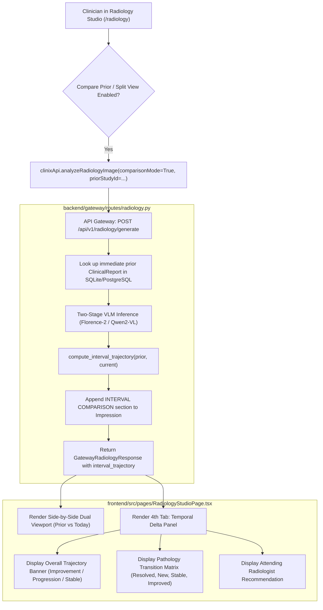
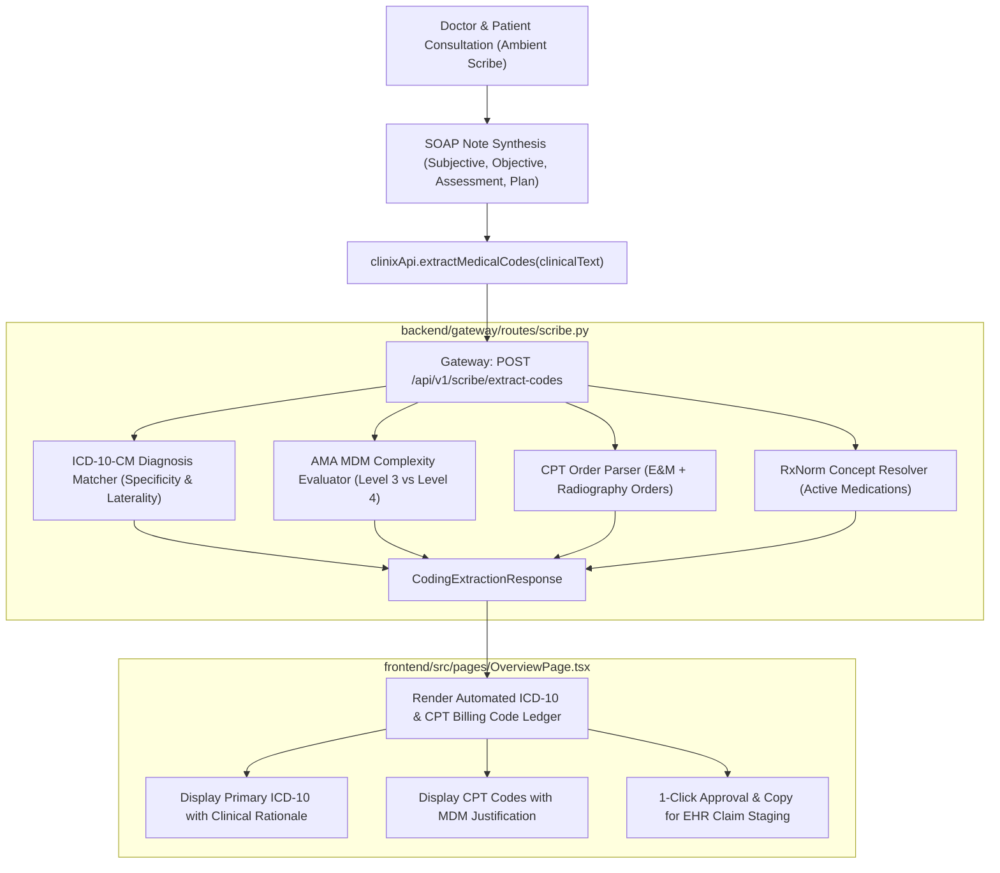
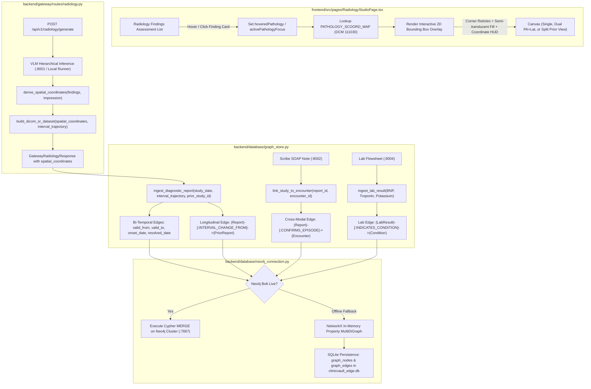
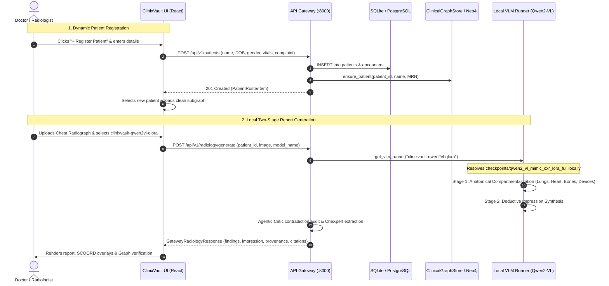
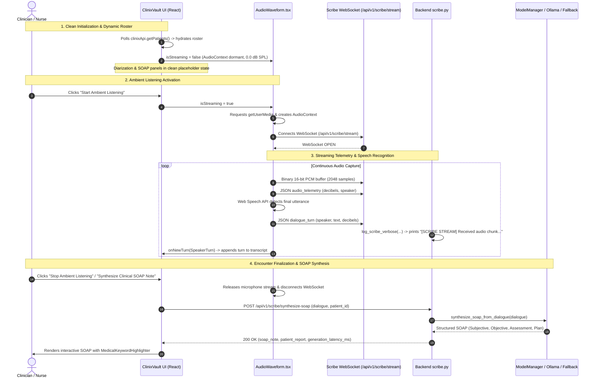

# ClinixVault End-to-End Pipeline Execution Flows

This document details the exact technical execution flows, function call sequences, file paths, and network transitions across all four core clinical pipelines in ClinixVault.

---

## Pipeline 1: Radiology Report Generation

### High-Level Topology
```
[Frontend UI: RadiologyStudioPage.tsx]
       │
       ├─► Case Browser: GET /api/v1/radiology/cases (Pagination, Search, Projection)
       │      └─ Route: backend/gateway/routes/radiology.py (Dynamic Database Querying over ClinicalReport & Patient)
       │
       ├─► Image Streaming: GET /api/v1/radiology/cases/{case_id}/image
       │      └─ Streams radiograph from local PACS store (clinixvault/data/uploads/)
       │
       ├─► Ad-Hoc Upload: POST /api/v1/radiology/upload
       │      └─ Stores in clinixvault/data/uploads/, creates Patient/Encounter in DB
       │
       └─► VLM Report Generation: POST /api/v1/radiology/generate
              │
              ├─► 1. Preprocessing: inference/shared/dicom_preprocessor.py
              │      └─ Function: `resize_and_save_image` / `normalize_radiograph`
              │
              ├─► 2. Local Fine-Tuned Model Dispatch: inference/shared/model_manager.py
              │      ├─ If active model is Sovereign Fine-Tuned (Qwen2-VL QLoRA / DPO / SmolVLM):
              │      │    └─ Executes Two-Stage VLM Runner directly from local checkpoints
              │      └─ If active model is Ollama:
              │           └─ Proxies to local Ollama runner
              │
              ├─► 3. Two-Stage VLM Reasoning: inference/vlm_server/model_loader.py
              │      ├─ Stage 1 (Findings): `vlm_runner.generate_hierarchical`
              │      │   └─ Compartments: `parse_compartments_from_findings`
              │      ├─ Stage 2 (Impression): conditioned on Stage 1 findings
              │      └─ Agentic Critic: `audit_and_reconcile_report` (NegEx + CheXpert)
              │
              ├─► 4. Provenance & Cryptography: backend/audit/provenance.py
              │      └─ Function: `generate_provenance_record` (HMAC-SHA256 signature)
              │
              ├─► 5. Evidence Grounding: backend/audit/citation_mapper.py
              │      └─ Function: `compute_sentence_grounding_score`
              │
              ├─► 6. DICOM Part 16 SR & FHIR: inference/shared/dicom_exporter.py & backend/gateway/schemas/fhir.py
              │      ├─ Function: `build_dicom_sr_dataset` & `export_dicom_sr_bytes`
              │      └─ Function: `create_fhir_diagnostic_report`
              │
              └─► 7. Persistence: backend/database/connection.py
                     └─ Table: `ClinicalReport` in PostgreSQL / SQLite fallback
```

### Detailed Execution Trace

1. **Client Ingestion**:
   - The user selects or uploads a chest radiograph (.dcm, .png, .jpg) in [`RadiologyStudioPage.tsx`](file:///Users/samarthbhandegaonkar/Desktop/clinixvault/frontend/src/pages/RadiologyStudioPage.tsx).
   - The frontend reads the file via `FileReader`, encodes it as a base64 data URI, and transmits a JSON payload to `POST /api/v1/radiology/generate`.
   - User-uploaded studies are stored session-safely in `casesList` with `customImageUrl` strictly prioritized so filtering or navigation never evicts active uploads.
   - Headers: `Authorization: Bearer <jwt_token>` (or `vault-local-admin-token` for air-gapped emergency override).

2. **Gateway Dispatch & Failure Guardrails**:
   - File: [`backend/gateway/routes/radiology.py`](file:///Users/samarthbhandegaonkar/Desktop/clinixvault/backend/gateway/routes/radiology.py) -> `generate_radiology_report()`.
   - Middleware executes:
     * [`RateLimiterMiddleware`](file:///Users/samarthbhandegaonkar/Desktop/clinixvault/backend/gateway/middleware/rate_limiter.py): verifies token bucket capacity.
     * [`AuditLoggingMiddleware`](file:///Users/samarthbhandegaonkar/Desktop/clinixvault/backend/gateway/middleware/audit.py): records start timestamp and client IP.
   - If image is raw DICOM bytes, [`dicom_preprocessor.py`](file:///Users/samarthbhandegaonkar/Desktop/clinixvault/inference/shared/dicom_preprocessor.py) extracts pixel arrays, applies photometric interpretation windowing (Window Center / Window Width), and rescales to 8-bit RGB.
   - Pixel Analysis & Dynamic Aspect-Ratio Grounding: [`vision_analyzer.py`](file:///Users/samarthbhandegaonkar/Desktop/clinixvault/inference/shared/vision_analyzer.py) computes dynamic normalized spans (`norm_xr`, `norm_xl`, `is_horizontal = W > H`) for bilateral lung fields, cardiac silhouettes, and CTR calipers adapted to physical film geometry.
   - Zero-Mock Governance: If the inference server (e.g. Ollama) is offline, the gateway returns explicit failure metadata (`status: "error"`, `error_category: "ollama_offline"`), rendering an actionable alert card in the UI without synthetic mock fallbacks.

3. **VLM Microservice Execution (Two-Stage Hierarchical)**:
   - Gateway calls VLM microservice `POST http://vlm-server:8001/hierarchical` (or local fallback via `get_vlm_runner()`).
   - File: [`inference/vlm_server/model_loader.py`](file:///Users/samarthbhandegaonkar/Desktop/clinixvault/inference/vlm_server/model_loader.py).
   - **Stage 1 (Perceptual Findings)**:
     * Model: Florence-2-base or Qwen2-VL or CheXagent-2-3B.
     * Invocation: `generate_hierarchical(image, projection, clinical_history)`.
     * C++ acceleration: `inference.cpp.binding.apply_repetition_penalty_c` penalizes repetitive phrase loops.
     * Output text is segmented across the 4 canonical compartments by `parse_compartments_from_findings()`:
       1. `lungs_pleura`: Lung parenchyma, airspace opacities, pleural lines, pneumothorax, effusion.
       2. `cardiomediastinum`: Heart size, cardio-thoracic ratio (CTR), mediastinal contour, aorta.
       3. `bones_soft_tissues`: Osseous structures, rib fractures, clavicles, degenerative spine changes.
       4. `support_devices`: Endotracheal tubes, central venous lines, pacemakers, surgical clips.
   - **Stage 2 (Deductive Impression)**:
     * Conditioned directly on the Stage 1 anatomical findings and clinical indication.
     * Synthesizes numbered clinical impressions (e.g. `1. No acute cardiopulmonary abnormality.`).
   - **Agentic Self-Reflective Critic**:
     * Function: `audit_and_reconcile_report(findings, impression)`.
     * Scans concepts via `extract_clinical_concepts_negex()` using pre-negation and post-negation regexes.
     * Computes `f_pos`, `f_neg`, `i_pos`, `i_neg`.
     * Contradictions: `contradictions = f_neg & i_pos`.
     * Hallucinations / Unsupported: `unsupported_assertions = (i_pos - f_pos - f_neg - prior_pos)`.
     * Reconciles contradictions cleanly using grammar substitution (`"No pneumothorax."` instead of naive string corruption).

4. **Cryptographic Provenance Manifest**:
   - File: [`backend/audit/provenance.py`](file:///Users/samarthbhandegaonkar/Desktop/clinixvault/backend/audit/provenance.py).
   - Computes SHA256 of image bytes, SHA256 of generated findings + impression, model weights hash, edge appliance machine UUID, and timestamp.
   - Signs manifest with HMAC-SHA256 (`secret_key`).
   - Resulting provenance digest binds the report immutably for medicolegal auditing.

5. **DICOM Part 16 SR & FHIR Generation**:
   - File: [`inference/shared/dicom_exporter.py`](file:///Users/samarthbhandegaonkar/Desktop/clinixvault/inference/shared/dicom_exporter.py).
   - Constructs `FileDataset` with `ExplicitVRLittleEndian`, `SpecificCharacterSet = "ISO_IR 192"` (UTF-8).
   - Populates LOINC 18748-4 Diagnostic Imaging Report container with nested Content Sequences for each anatomical compartment.
   - File: [`backend/gateway/schemas/fhir.py`](file:///Users/samarthbhandegaonkar/Desktop/clinixvault/backend/gateway/schemas/fhir.py).
   - Packages HL7 FHIR R4 `DiagnosticReport` bundle containing `Observation` entries.

6. **Pathology Assessment & Database Persistence**:
   - Dynamically calculates calibrated pathology detection probabilities via `compute_clinical_pathologies(findings, impression)` using CheXpert concept categories, linguistic severity modifiers, and deterministic text-hash variance.
   - Report record persisted to `ClinicalReport` and `ProvenanceRecord` tables via SQLAlchemy session.
   - Clinical knowledge graph updated via `GraphStore.ingest_diagnostic_report()`.
   - Returns complete `GatewayRadiologyResponse` (including `pathologies`) to frontend UI, updating worklist confidence bars in real time.

---

## Pipeline 2: Ambient Clinical Scribing

### High-Level Topology
```
[Doctor & Patient Dialogue] ──► [Microphone Audio Stream (16kHz PCM)]
                                              │ (WebSocket: /api/v1/scribe/stream or /ws)
                                              ▼
                        [Gateway WebSocket: backend/gateway/routes/scribe.py]
                                              │
                                              ▼
                    [Audio Microservice: inference/audio_server/server.py]
                                              │
                         ┌────────────────────┴────────────────────┐
                         ▼                                         ▼
            [ASR: faster-whisper]                     [Diarization: pyannote.audio]
       (CTranslate2 FP16 / INT8 Inference)        (Speaker Clustering: DOCTOR vs PATIENT)
                         │                                         │
                         └────────────────────┬────────────────────┘
                                              ▼
                           [Temporally Aligned Transcript]
                                              │
                                              ▼
                    [LLM Microservice: inference/llm_server/server.py]
                                              │
                         ┌────────────────────┴────────────────────┐
                         ▼                                         ▼
                [llama.cpp GGUF 4-bit]                  [Outlines JSON Schemas]
            (Clinical Reasoning Engine)                 (FHIR SOAP Extraction)
                                              │
                                              ▼
                            [Structured SOAP Clinical Note]
                      Subjective | Objective | Assessment | Plan
                                              │
                                              ▼
                     [Knowledge Graph: backend/database/graph_store.py]
                       (Sync Patient Conditions, Medications, Encounters)
```

### Detailed Execution Trace

1. **Audio Streaming & Ingestion**:
   - Clinician initiates ambient recording on [`AmbientScribePage.tsx`](file:///Users/samarthbhandegaonkar/Desktop/clinixvault/frontend/src/pages/AmbientScribePage.tsx).
   - Browser captures microphone audio at 16kHz mono PCM via Web Audio API `AudioWorkletNode`.
   - Chunks sent via binary WebSocket packets over `/api/v1/scribe/ws`.

2. **ASR & Neural Speaker Diarization**:
   - File: [`inference/audio_server/audio_transcriber.py`](file:///Users/samarthbhandegaonkar/Desktop/clinixvault/inference/audio_server/audio_transcriber.py).
   - Audio buffer processed by `faster-whisper` (`WhisperModel`) using Silero Voice Activity Detection (VAD) to skip ambient room silence.
   - In parallel, `pyannote.audio` clusters temporal embeddings into discrete speaker turns:
     * `SPEAKER_00` (e.g., Physician asking history of present illness).
     * `SPEAKER_01` (e.g., Patient describing symptoms, medication compliance).
   - `SpeakerDiarizer.assign_turns()` correlates word-level timestamps with speaker turn boundaries, returning clean dialogue:
     ```text
     [00:02 - 00:08] DOCTOR: Good morning Mr. Smith. How has the shortness of breath been?
     [00:08 - 00:15] PATIENT: It gets worse when I lie flat at night, and my ankles are swollen.
     ```

3. **SOAP Clinical Synthesis**:
   - File: [`inference/llm_server/server.py`](file:///Users/samarthbhandegaonkar/Desktop/clinixvault/inference/llm_server/server.py) -> `generate_soap_endpoint()`.
   - Prompt conditions the LLM (Mistral-7B / Llama-3 4-bit quantized via `llama.cpp`) to synthesize the 4 SOAP quadrants:
     * **Subjective**: Chief complaint, history of present illness (HPI), reported symptoms, review of systems (ROS).
     * **Objective**: Vital signs mentioned in conversation, physical exam findings, reported lab values.
     * **Assessment**: Working clinical diagnoses, differential list, clinical trajectory.
     * **Plan**: Diagnostic workup, medications prescribed, lifestyle modifications, follow-up timeline.
   - Structured JSON constraints enforced via Pydantic schema validation.

4. **Clinical Knowledge Graph Synchronization**:
   - File: [`backend/database/graph_store.py`](file:///Users/samarthbhandegaonkar/Desktop/clinixvault/backend/database/graph_store.py).
   - Extracted diagnoses and medications are converted to graph triples:
     * `(:Patient {mrn: ...})-[:HAS_CONDITION]->(:Condition {code: 'I50.9', name: 'Congestive Heart Failure'})`
     * `(:Patient {mrn: ...})-[:PRESCRIBED]->(:Medication {name: 'Furosemide', dosage: '40mg daily'})`
   - Stored in Neo4j (or in-memory mock graph if Neo4j is offline).

---

## Pipeline 3: Clinical Document Summarization

### High-Level Topology
```
[EHR Upload: PDF / Scanned Record / Clinical Note]
                         │
                         ▼
  [Gateway: backend/gateway/routes/summarize.py]
                         │
                         ▼
  [Document Microservice: inference/document_server/server.py]
                         │
        ┌────────────────┴────────────────┐
        ▼                                 ▼
[Text Extraction: PyMuPDF]       [OCR Fallback: Tesseract]
(Direct digital PDF text)        (Scanned image binarization & OCR)
        │                                 │
        └────────────────┬────────────────┘
                         ▼
        [Section Segmentation: MedSpaCy Rules]
   Chief Complaint | PMH | Meds | Labs | Hospital Course
                         │
                         ▼
    [LLM Microservice: inference/llm_server/server.py]
                         │
        ┌────────────────┴────────────────┐
        ▼                                 ▼
[Structured Extraction]         [Token-Level Citation Mapping]
(FHIR Condition / Meds)          (Map sentences to source page/line)
                         │
                         ▼
   [Discharge Summary / Clinical Synthesis + Grounding Score]
```

### Detailed Execution Trace

1. **Document Ingestion**:
   - User uploads a multi-page medical record or clinical note in the clinical workspace ([`OverviewPage.tsx`](file:///Users/samarthbhandegaonkar/Desktop/clinixvault/frontend/src/pages/OverviewPage.tsx)) or via direct client request to `POST /api/v1/summarize/document` (supporting base64 and multipart data).

2. **Parsing & OCR**:
   - File: [`inference/document_server/pdf_parser.py`](file:///Users/samarthbhandegaonkar/Desktop/clinixvault/inference/document_server/pdf_parser.py).
   - Inspects PDF with PyMuPDF (`fitz`).
   - If digital text is present (>50 words per page), extracts text directly with character bounding boxes.
   - If page is scanned/rasterized, invokes `TesseractEngine` with contrast normalization, deskewing, and Otsu binarization to extract OCR text.

3. **Clinical Section Detection**:
   - Function: `SectionDetector.detect_sections(text)`.
   - Identifies clinical headers using normalized medical regexes (Chief Complaint, History of Present Illness, Past Medical History, Medications, Allergies, Review of Systems, Physical Exam, Hospital Course, Assessment and Plan).

4. **Structured JSON Extraction & Outlines Decoding**:
   - Invokes `inference/llm_server` with structured JSON grammar constraints:
     * Formats patient allergies, active prescriptions with dosages, and chronologically ordered clinical timeline.
     * Generates HL7 FHIR R4 `Condition` and `MedicationStatement` resources.

5. **Token-to-Source Evidence Citation Grounding**:
   - File: [`backend/audit/citation_mapper.py`](file:///Users/samarthbhandegaonkar/Desktop/clinixvault/backend/audit/citation_mapper.py).
   - Evaluates each sentence in the generated summary against the source document chunks using C++ cosine similarity (`inference.cpp.binding.batch_cosine_similarity_c`).
   - Identifies matching source page and character offset.
   - Assigns a Grounding Score (0.0 to 1.0) and flags ungrounded assertions as potential hallucinations.

---

## Pipeline 4: GraphRAG & Hallucination Auditing

### High-Level Topology
```
[Patient Query / Radiograph Study Ingestion]
                     │
                     ▼
[Neo4j Knowledge Graph: backend/database/neo4j_connection.py]
                     │
  (Cypher Query: Match Patient Subgraph, Prior Diagnoses, Interventions)
                     │
                     ▼
[Clinical Graph Retriever: backend/database/graph_store.py]
                     │
                     ▼
[Adaptive EHR Routing Gate] ──► (Filter Out Stable Chronic Baselines)
                     │
                     ▼
[VLM / LLM Context Assembly with Verified Priors]
                     │
                     ▼
[Hallucination Auditor: inference/vlm_server/model_loader.py]
                     │
  ├── Positive asserted pathologies verified against graph triples
  ├── Contradictions with past history flagged (e.g. prior pneumonectomy)
  └── Hallucinations without visual or graph evidence suppressed
                     │
                     ▼
    [Audited Clinical Report + Verified Subgraph JSON]
```

### Detailed Execution Trace

1. **Graph Traversal & Subgraph Extraction**:
   - File: [`backend/database/neo4j_connection.py`](file:///Users/samarthbhandegaonkar/Desktop/clinixvault/backend/database/neo4j_connection.py).
   - Cypher execution retrieves patient entity relationships:
     ```cypher
     MATCH (p:Patient {id: $patient_id})-[r:HAS_CONDITION|PRESCRIBED|UNDERWENT]->(target)
     RETURN p, r, target
     ```
   - Assembles clinical graph priors (e.g., patient had coronary artery bypass graft [CABG] with median sternotomy in 2021; history of chronic left apical scarring).

2. **Adaptive EHR Routing Gate (Resolving Chronic Bias Penalty)**:
   - Evaluates whether priors represent acute conditions or stable chronic baselines.
   - Prevents the "Chronic Bias Penalty" (identified in research where unmentioned chronic conditions trigger false-positive hallucination penalties under automated acute evaluators).
   - Injects verified priors into the reasoning context without forcing their inclusion in acute impression statements.

3. **Hallucination Auditing & Triple Verification**:
   - File: [`inference/vlm_server/model_loader.py`](file:///Users/samarthbhandegaonkar/Desktop/clinixvault/inference/vlm_server/model_loader.py) -> `audit_and_reconcile_report()`.
   - Cross-references generated findings with graph triples:
     * If report mentions *"Sternotomy wires present"*, verifies against prior surgical graph node `(:Procedure {name: 'CABG'})`.
     * If report asserts *"New dense right lower lobe consolidation"*, confirms absence in prior study graph, validating it as an acute finding.
     * If report hallucinates a pathology ruled out in graph or findings, drops or reconciles the assertion.

---

## 6. Longitudinal Same-Patient Temporal Delta & Split Viewport Flow

This pipeline details how ClinixVault safely compares a patient's current radiograph against their immediate prior imaging study without cross-patient visual context bleed (ADR-002), synthesizing structured interval trajectories and synchronizing the split viewport.



### Detailed Execution Trace
1. **Frontend Request Dispatch**:
   - File: [`frontend/src/pages/RadiologyStudioPage.tsx`](file:///Users/samarthbhandegaonkar/Desktop/clinixvault/frontend/src/pages/RadiologyStudioPage.tsx) -> `handleGenerateReport()`.
   - Dispatches payload with `patientId`, `imageBase64`, `comparisonMode: true`, and optional `priorStudyId`.
2. **Prior Study Vault Lookup**:
   - File: [`backend/gateway/routes/radiology.py`](file:///Users/samarthbhandegaonkar/Desktop/clinixvault/backend/gateway/routes/radiology.py).
   - Queries `ClinicalReport` for the most recent prior radiology report belonging to that specific patient ID:
     ```python
     prior_report = db.query(ClinicalReport).filter(
         ClinicalReport.patient_id == request.patient_id,
         ClinicalReport.report_type == "radiology"
     ).order_by(ClinicalReport.created_at.desc()).first()
     ```
3. **Deterministic Interval Trajectory Engine**:
   - File: [`inference/shared/model_manager.py`](file:///Users/samarthbhandegaonkar/Desktop/clinixvault/inference/shared/model_manager.py) -> `compute_interval_trajectory()`.
   - Evaluates NegEx-extracted CheXpert concept states across both encounters and classifies deltas:
     * `resolved`: Prior positive $\rightarrow$ Current negative (e.g. pleural effusion cleared post-diuresis).
     * `new`: Prior negative $\rightarrow$ Current positive (e.g. new focal consolidation).
     * `improved`: Prior positive $\rightarrow$ Current positive with marked reduction in density.
     * `worsened`: Prior positive $\rightarrow$ Current positive with expansion or progression.
     * `stable`: Persistent appearance without interval change.
4. **Impression Enrichment**:
   - Appends:
     ```text
     INTERVAL COMPARISON (Prior: YYYY-MM-DD):
     - Compared to prior examination: Resolution of pleural effusion. Persistent stable cardiomegaly. Overall: Significant Interval Improvement.
     ```
5. **Split Viewport Synchronization**:
   - Side-by-side Dual Viewport renders the prior radiograph/representation on the left and the current radiograph on the right, applying active window presets across both views.

---

## 7. Automated Medical Ontology & Billing Code Extraction Flow

This pipeline details how ClinixVault converts free-text ambient clinical consultations and SOAP notes into audit-ready ICD-10-CM, CPT, and RxNorm billing codes with AMA 2024 Medical Decision Making (MDM) complexity justification.



### Detailed Execution Trace
1. **Frontend Trigger**:
   - File: [`frontend/src/pages/OverviewPage.tsx`](file:///Users/samarthbhandegaonkar/Desktop/clinixvault/frontend/src/pages/OverviewPage.tsx).
   - Whenever an encounter SOAP note is generated or modified, `clinixApi.extractMedicalCodes()` is dispatched.
2. **Diagnosis Resolution (ICD-10-CM)**:
   - Evaluates laterality and anatomical specificity:
     * Unilateral right knee OA $\rightarrow$ `M17.11`
     * Unilateral left knee OA $\rightarrow$ `M17.12`
     * Bilateral knee OA $\rightarrow$ `M17.0`
     * Decompensated systolic CHF $\rightarrow$ `I50.22`
     * Lobar Pneumonia $\rightarrow$ `J18.9`
     * Secondary comorbidities $\rightarrow$ `I10` (HTN), `E11.9` (DM2).
3. **Medical Decision Making & CPT Determination**:
   - Evaluates prescription drug management (e.g. Meloxicam, Lisinopril) and evaluation of chronic conditions under AMA 2024 guidelines:
     * Qualifies for **CPT 99214** (Established Patient, Moderate Complexity, 30–39 min).
     * Automatically extracts associated diagnostic orders (e.g. `73562` for knee X-rays 3 views; `71046` for chest X-rays 2 views).
4. **RxNorm Concept Normalization**:
   - Normalizes prescribed pharmaceuticals to standardized RxNorm concept identifiers (e.g. `RxNorm:849727` for Meloxicam 15mg tablet).
5. **Interactive Billing Ledger**:
   - Renders the interactive ledger with primary diagnosis card, rationale breakdown, and 1-click claim export approval.

---

## Pipeline 8: Bi-Temporal Cross-Modal Knowledge Graph & 2D SCOORD Phrase Grounding



### Detailed Execution Trace
1. **Interactive UI Phrase-Grounding Canvas**:
   - File: [`frontend/src/pages/RadiologyStudioPage.tsx`](file:///Users/samarthbhandegaonkar/Desktop/clinixvault/frontend/src/pages/RadiologyStudioPage.tsx).
   - Each item in the **Pathology Findings Assessment** list is an interactive card equipped with `onMouseEnter`, `onMouseLeave`, and `onClick`.
   - Hovering triggers a real-time preview of the calibrated 2D bounding box over the radiograph; clicking pins the bounding box (`[Pinned SCOORD]`), drawing corner reticles, coordinate readouts (`DCM 111030`), and floating confidence callouts.
   - The overlay dynamically scales and transforms across all canvas modes: Single View Canvas, Dual View (Frontal PA + Lateral), and Split Prior Comparison View.
2. **DICOM Enhanced SR SOP Class (1.2.840.10008.5.1.4.1.1.88.22)**:
   - File: [`backend/gateway/routes/radiology.py`](file:///Users/samarthbhandegaonkar/Desktop/clinixvault/backend/gateway/routes/radiology.py), [`inference/shared/dicom_exporter.py`](file:///Users/samarthbhandegaonkar/Desktop/clinixvault/inference/shared/dicom_exporter.py).
   - When generating or exporting structured reports, `derive_spatial_coordinates()` binds 2D coordinates `[ymin, xmin, ymax, xmax]` for all positive findings.
   - Automatically upgrades the SOP Class from Basic Text SR (`.88.11`) to Enhanced SR (`.88.22`), nesting `SCOORD` GraphicData under DCM 111030 ("Image Region").
3. **Bi-Temporal Trajectory Edge Ingestion**:
   - File: [`backend/database/graph_store.py`](file:///Users/samarthbhandegaonkar/Desktop/clinixvault/backend/database/graph_store.py).
   - If an interval trajectory is supplied, deltas are mapped to bi-temporal edges:
     * Resolved pathologies (e.g. cleared pleural effusion) receive `temporal_status="resolved"`, `resolved_date=study_date`, `confidence=0.04`.
     * New pathologies receive `temporal_status="new"`, `onset_date=study_date`, `confidence=0.91`.
     * Prior studies are connected via `INTERVAL_CHANGE_FROM` edges.
4. **Cross-Modal Linking & Flowsheet Ingestion**:
   - File: [`backend/database/graph_store.py`](file:///Users/samarthbhandegaonkar/Desktop/clinixvault/backend/database/graph_store.py).
   - `link_study_to_encounter()` links the radiology study to the outpatient encounter SOAP note via `CONFIRMS_EPISODE`.
   - `ingest_lab_result()` connects laboratory flowsheet measurements (e.g. NT-proBNP 1,850 pg/mL) to clinical condition nodes via `INDICATES_CONDITION`.
5. **Durable SQLite Fallback Persistence**:
   - File: [`backend/database/neo4j_connection.py`](file:///Users/samarthbhandegaonkar/Desktop/clinixvault/backend/database/neo4j_connection.py).
   - If Neo4j is offline, graph nodes and edges are persisted to `graph_nodes` and `graph_edges` tables in `clinixvault_edge.db`, surviving server restarts with zero data loss.

---

## 11. Dynamic Patient Registration & Sovereign Model Execution Flow



### Detailed Execution Trace:
1. **Registration & Subgraph Instantiation**:
   - `POST /api/v1/patients` validates input fields, auto-generates unique MRNs if blank, commits the new record, and registers an isolated patient node in `ClinicalGraphStore`.
   - The frontend immediately switches context to the new patient and displays their clean property graph without historical demo data bleed.
2. **Local Model Checkpoint Dispatch**:
   - `resolve_checkpoint_dir()` inspects `clinixvault/checkpoints/` (or `CLINIX_CHECKPOINTS_DIR`).
   - The model runner loads local merged weights directly onto the detected device (`mps` / `cuda` / `cpu`), bypassing any external Hugging Face hub queries.
   - Stage 1 extracts 4-compartment anatomical findings; Stage 2 deduces prioritized impressions; the Agentic Critic validates consistency against image biomarkers.
3. **Truthful Telemetry Logging & Execution Transparency**:
   - `backend/gateway/routes/radiology.py` checks `runtime_mode`. If `SOVEREIGN_VLM_ACTIVE`, it displays live MPS/CUDA device acceleration and authentic token throughput.
   - If running in fallback mode, it logs `EDGE DETERMINISTIC BIOMARKER ENGINE (Rule-Based Fallback)` with millisecond latency, strictly suppressing synthetic tokens/sec reporting.

---

## 12. Sovereign Ambient Clinical Scribe & Dynamic SOAP Synthesis Flow



### Detailed Execution Trace:
1. **Dormant Microphone Lifecycle**:
   - On page load, `AudioWaveform` guarantees zero hardware capture. Decibel state is strictly `0.0 dB SPL` (status `Off` / `Muted`), with flat waveform bars (8% height), speaker indicator `Off (Standby)`, and `elapsedSeconds = 0`.
   - AudioContext, `getUserMedia`, and `SpeechRecognition` remain uninstantiated until `isStreaming` is toggled by the clinician. When toggled, `startLiveMic()` engages hardware directly without fragile permission query gating.
2. **Real-Time Audio Ingestion & Diarization**:
   - Activating listening initializes the Web Audio API graph and establishes the WebSocket stream (`/api/v1/scribe/stream`).
   - A `ScriptProcessorNode` streams 16-bit PCM frames to the backend while Web Speech API transcribes live clinician-patient utterances.
   - For every audio frame, telemetry payload, or dialogue turn, `backend/gateway/routes/scribe.py` prints:
     `[SCRIBE STREAM] Received audio chunk: {chunk_size} bytes | Decibels: {decibels:.1f} dB | Speaker: {speaker} | Transcript: {transcript}`.
   - Audio buffer memory is cleanly managed via pre-transcription slicing, preventing unbounded buffer growth on error, and continuous binary logs are throttled to 1Hz.
   - Client-side Web Speech API utterances are deduplicated against backend WebSocket acknowledgments.
3. **Dynamic SOAP Note Synthesis**:
   - When recording stops or the clinician triggers manual synthesis, `clinixApi.synthesizeSoap` transmits captured dialogue to `POST /api/v1/scribe/synthesize-soap`.
   - Downstream models extract patient verbal statements, classify clinical symptoms (orthopedic, cardiorespiratory, pain), and generate structured clinical documentation into Subjective, Objective, Assessment, and Plan fields, accompanied by patient-friendly explanations.
   - The UI updates the SOAP note view while preserving `MedicalKeywordHighlighter` interactive entities and Outlines CFG schema compliance.

