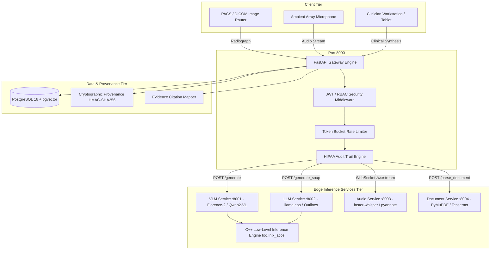

# ClinixVault: Air-Gapped Edge AI Clinical Appliance System Design

## 1. System Overview & Executive Summary

**ClinixVault** is an air-gapped, zero-egress clinical edge AI appliance tailored for healthcare institutions, regional hospitals, and emergency rooms. It delivers multi-modal clinical intelligence:
1. **Automated Radiology Report Generation**: Multi-modal vision-language models (fine-tuned Florence-2 and Qwen2-VL) producing structured clinical findings and impressions from frontal/lateral chest radiographs.
2. **Ambient Clinical Scribing**: Speech-to-text with speaker diarization (`faster-whisper` + `pyannote.audio`) converting real-time physician-patient dialogues into standard SOAP notes.
3. **Clinical Record Synthesis & EHR Interoperability**: LLM summarization powered by C++ llama.cpp, generating FHIR R4 resources (DiagnosticReport, Observation, Condition) with token-to-source evidence citations and cryptographic provenance tracking.

---

## 2. High-Level Architecture Diagram

---

## 3. Microservice Specifications

### 3.1 VLM Radiology Server (Port 8001)
- **Model Support**: Microsoft Florence-2-base (230M params) and Qwen2-VL-2B/7B.
- **Quantization**: 4-bit NF4 / AWQ / FP16.
- **Acceleration**: C++ token repetition penalty kernel (`inference.cpp.binding`).
- **Output**: Standardized findings, impressions, detected CheXpert pathologies with confidence scores.

### 3.2 LLM Summarization & Scribe Server (Port 8002)
- **Engine**: C++ `llama-cpp-python` runtime executing GGUF 4-bit quantized Mistral-7B / Llama-3.
- **Structured Decoding**: Grammar-guided JSON constraint engine enforcing FHIR R4 schemas (`Observation`, `Condition`, `DiagnosticReport`).
- **SOAP Synthesis**: Extracts Subjective, Objective, Assessment, Plan, medication reconciliation, and allergy detection.

### 3.3 Audio Ambient Scribing Server (Port 8003)
- **ASR Engine**: `faster-whisper` using CTranslate2 C++ inference with voice activity detection (VAD).
- **Diarization**: `pyannote.audio` neural speaker clustering aligning temporal audio slices with `DOCTOR` vs `PATIENT` linguistic roles.
- **Streaming**: Full-duplex WebSocket (`/ws/stream`) accepting 16kHz PCM audio buffers.

### 3.4 Document Parsing & OCR Server (Port 8004)
- **PDF Engine**: PyMuPDF (`fitz`) with automated raster fallback for scanned records.
- **OCR Engine**: Tesseract OCR with adaptive contrast stretching and binarization.
- **Clinical Segmentation**: MedSpaCy clinical sectionizer identifying Chief Complaint, HPI, PMH, ROS, Physical Exam, and Assessment/Plan.

---

## 4. C++ Low-Level Acceleration Engine (`libclinix_accel`)

For maximum performance on resource-constrained edge hardware without dedicated enterprise GPUs, low-level numeric operations are offloaded to native C++17 shared libraries:
1. `apply_repetition_penalty_c`: In-place penalty scaling over large vocabulary arrays (32k - 150k tokens).
2. `top_k_top_p_filter_c`: Fast logit sorting and nucleus cumulative mass truncation.
3. `cosine_similarity_c`: SIMD-friendly vector dot-product and norm calculations.
4. `batch_cosine_similarity_c`: High-throughput embedding scoring for clinical RAG over thousands of historical patient reports.

---

## 5. Security, Audit, and Provenance

- **Air-Gapped Operation**: Zero outbound internet calls required during runtime.
- **JWT RBAC**: Stateless Bearer token verification supporting clinical roles (`radiologist`, `physician`, `nurse`, `auditor`, `admin`).
- **Cryptographic Provenance**: Every generated report is paired with an HMAC-SHA256 signature binding the output report text, model weights hash, input payload digest, timestamp, and edge node identity.
- **Evidence Citation Grounding**: Reports are sentence-segmented and mapped to source dialogue turns or clinical notes to calculate a grounding score and highlight hallucinations.

---

## 6. Training Pipeline (Kaggle & SSH Cloud)

- **Dataset**: MIMIC-CXR multi-view chest radiographs and clinical text reports.
- **Kaggle Optimization**:
  - Image downsampling to 384x384 (`preprocess_for_kaggle.py`), reducing 114GB raw files to an optimized portable dataset.
  - 12-hour session resilience: `kaggle_utils.py` saves checkpoints every 200 steps to `/kaggle/working/` and auto-resumes from previous runs.
  - Automatic checkpoint pruning to respect Kaggle's 20GB disk limit.
- **Evaluation**: Unified metrics engine calculating BLEU-4, ROUGE-L, BERTScore F1, CheXpert Clinical Concept Recall, and Hallucination Rate.
